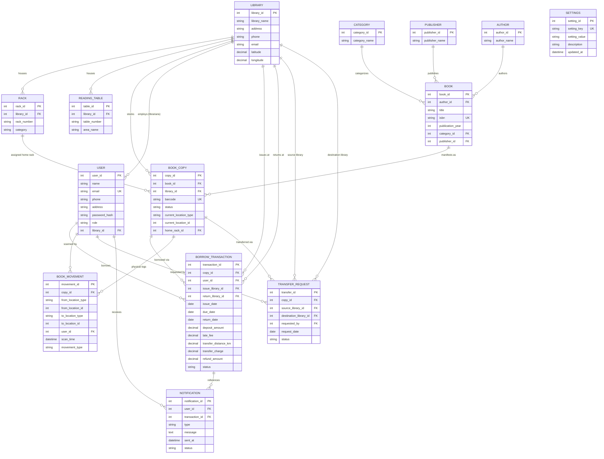

# Entity-Relationship (ER) Diagram & Relational Schema

**Project:** Smart, Connected Multi-Library Book Tracking & Discovery System  
**Reference:** Section 10.4 & Section 10.5 of `docs/PROJECT.md`  

---

## 1. Complete Entity-Relationship Diagram

---

## 2. Relational Schema Specification

### 1. `LIBRARY`
- **PK:** `library_id`
- **Attributes:** `library_name`, `address`, `phone`, `email`, `latitude`, `longitude`
- **Constraints:**
  - `CHECK (latitude BETWEEN -90.000000 AND 90.000000)`
  - `CHECK (longitude BETWEEN -180.000000 AND 180.000000)`

### 2. `RACK`
- **PK:** `rack_id`
- **FK:** `library_id` $\to$ `LIBRARY(library_id)` ON DELETE RESTRICT
- **Attributes:** `rack_number`, `category`
- **Constraints:** `UNIQUE (library_id, rack_number)`

### 3. `READING_TABLE`
- **PK:** `table_id`
- **FK:** `library_id` $\to$ `LIBRARY(library_id)` ON DELETE RESTRICT
- **Attributes:** `table_number`, `area_name`
- **Constraints:** `UNIQUE (library_id, table_number)`

### 4. `CATEGORY`
- **PK:** `category_id`
- **Attributes:** `category_name` (UNIQUE)

### 5. `PUBLISHER`
- **PK:** `publisher_id`
- **Attributes:** `publisher_name` (UNIQUE)

### 6. `AUTHOR`
- **PK:** `author_id`
- **Attributes:** `author_name`

### 7. `BOOK`
- **PK:** `book_id`
- **FKs:**
  - `author_id` $\to$ `AUTHOR(author_id)`
  - `category_id` $\to$ `CATEGORY(category_id)`
  - `publisher_id` $\to$ `PUBLISHER(publisher_id)`
- **Attributes:** `title`, `isbn` (UNIQUE), `publication_year`
- **Indexes:** `idx_book_title (title)`

### 8. `BOOK_COPY`
- **PK:** `copy_id`
- **FKs:**
  - `book_id` $\to$ `BOOK(book_id)`
  - `library_id` $\to$ `LIBRARY(library_id)`
  - `home_rack_id` $\to$ `RACK(rack_id)`
- **Attributes:** `barcode` (UNIQUE), `status` (`AVAILABLE`, `BORROWED`, `READING`, `IN_TRANSIT`, `RETURNING`, `LOST`), `current_location_type`, `current_location_id`
- **Indexes:** `idx_copy_book_status (book_id, status)`

### 9. `USER`
- **PK:** `user_id`
- **FK:** `library_id` $\to$ `LIBRARY(library_id)` (NULL for members/admin)
- **Attributes:** `name`, `email` (UNIQUE), `phone`, `address`, `password_hash`, `role` (`MEMBER`, `LIBRARIAN`, `ADMIN`)

### 10. `BORROW_TRANSACTION`
- **PK:** `transaction_id`
- **FKs:**
  - `copy_id` $\to$ `BOOK_COPY(copy_id)`
  - `user_id` $\to$ `USER(user_id)`
  - `issue_library_id` $\to$ `LIBRARY(library_id)`
  - `return_library_id` $\to$ `LIBRARY(library_id)`
- **Attributes:** `issue_date`, `due_date`, `return_date`, `deposit_amount`, `late_fee`, `transfer_distance_km`, `transfer_charge`, `refund_amount`, `status` (`ISSUED`, `RETURNED`, `RETURNED_ALT_LIBRARY`, `OVERDUE`)
- **Constraints:** `CHECK (due_date >= issue_date)`
- **Indexes:** `idx_borrow_user_status (user_id, status)`

### 11. `BOOK_MOVEMENT`
- **PK:** `movement_id`
- **FKs:**
  - `copy_id` $\to$ `BOOK_COPY(copy_id)`
  - `user_id` $\to$ `USER(user_id)`
- **Attributes:** `from_location_type`, `from_location_id`, `to_location_type`, `to_location_id`, `scan_time`, `movement_type` (`PICKED`, `PLACED_RACK`, `PLACED_TABLE`, `ISSUED`, `RETURNED`, `TRANSFER_DISPATCH`, `TRANSFER_RECEIVE`)
- **Indexes:** `idx_movement_copy (copy_id)`

### 12. `TRANSFER_REQUEST`
- **PK:** `transfer_id`
- **FKs:**
  - `copy_id` $\to$ `BOOK_COPY(copy_id)`
  - `source_library_id` $\to$ `LIBRARY(library_id)`
  - `destination_library_id` $\to$ `LIBRARY(library_id)`
  - `requested_by` $\to$ `USER(user_id)`
- **Attributes:** `request_date`, `status` (`PENDING`, `APPROVED`, `IN_TRANSIT`, `RECEIVED`, `CANCELLED`)
- **Constraints:** `CHECK (source_library_id <> destination_library_id)`
- **Indexes:** `idx_transfer_status (status)`

### 13. `NOTIFICATION`
- **PK:** `notification_id`
- **FKs:**
  - `user_id` $\to$ `USER(user_id)`
  - `transaction_id` $\to$ `BORROW_TRANSACTION(transaction_id)`
- **Attributes:** `type` (`DUE_REMINDER`, `RETURN_CONFIRMATION`, `WRONG_RACK`, `TRANSFER_UPDATE`), `message`, `sent_at`, `status` (`UNREAD`, `READ`)

### 14. `SETTINGS`
- **PK:** `setting_id`
- **Attributes:** `setting_key` (UNIQUE), `setting_value`, `description`, `updated_at`
